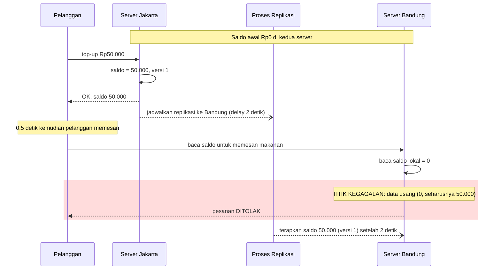
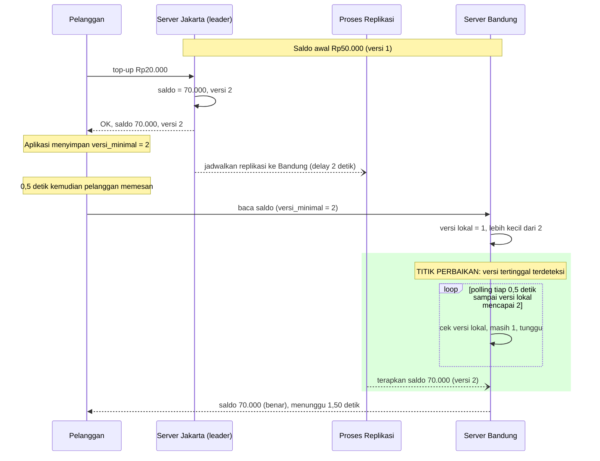

# Tugas 7 (Pekan 7) — Konsistensi Data

**Materi terkait:** Data-Centric Consistency (Sequential, Eventual), Client-Centric Consistency.

## Studi Kasus

Data saldo *e-wallet* pelanggan FoodGo berbeda antara server wilayah **Jakarta** dan **Bandung** karena replikasi antar server berjalan lambat. Contoh kasus nyata: pelanggan top-up saldo lewat server Jakarta, lalu dalam hitungan detik memesan makanan lewat aplikasi yang tersambung ke server Bandung — saldo belum ter-update, transaksi ditolak padahal saldo sebenarnya cukup.

## Tugas Kelompok

### Bagian 1 — Analisis (wajib)

1. Tentukan: apakah kasus ini **membutuhkan Sequential Consistency** (semua replika melihat urutan operasi yang sama) atau **cukup Eventual Consistency** (replika akan konsisten "pada akhirnya", boleh sementara berbeda)? Berikan argumen berbasis dampak bisnis (mis. kasus saldo *e-wallet* jauh lebih sensitif dibanding kasus "jumlah like" di media sosial).
2. Jika kalian menyimpulkan Eventual Consistency saja **tidak cukup** untuk skenario ini, usulkan pendekatan **Client-Centric Consistency** yang relevan (mis. *Read-Your-Writes*: pelanggan yang baru top-up harus selalu melihat saldo terbarunya sendiri, walau replika lain belum sinkron).
3. Gambarkan **diagram alir urutan (sequence diagram)** yang menunjukkan operasi read/write antara pelanggan, server Jakarta, server Bandung, dan proses replikasi — untuk skenario **tanpa** jaminan konsistensi (bug terjadi) DAN skenario **dengan** solusi yang kalian usulkan (bug teratasi). Pakai Mermaid (`sequenceDiagram`) di `README.md` — lihat contoh cara pakai di Tugas 2.

### Bagian 2 — Simulasi (opsional, nilai tambah)

Skeleton `src/replica_simulation.py` mensimulasikan dua replika (Jakarta & Bandung) dengan delay replikasi buatan. Lengkapi TODO untuk:
1. Menunjukkan kondisi **inconsistent read** (replika Bandung masih menunjukkan saldo lama walau Jakarta sudah update).
2. Mengimplementasikan mekanisme **Read-Your-Writes** sederhana (mis. dengan version/timestamp per client) yang memperbaiki masalah tersebut.

```bash
python3 src/replica_simulation.py
```

## Analisis

### 1. Model konsistensi yang dipilih

Bug terjadi karena replikasi Jakarta ke Bandung berjalan asinkron (di simulasi, delay 2 detik). Pelanggan yang baru top-up lalu membaca dari Bandung mendapat saldo lama, sehingga pesanan yang sah ditolak.

| | Jumlah like | Saldo e-wallet |
|---|---|---|
| Dampak data usang | Selisih kecil sesaat, tidak merugikan siapa pun | Transaksi sah ditolak, atau transaksi lolos padahal saldo habis |
| Sifat data | Statistik, boleh berupa perkiraan | Uang, harus akurat dan dapat diaudit |
| Risiko | Hampir nol | Pelanggan kecewa, merchant gagal dibayar, FoodGo menanggung selisih |

Ada dua masalah berbeda. Pertama, **baca data usang**: pelanggan tidak melihat top-up miliknya sendiri, yang merusak pengalaman tetapi belum merusak data. Kedua, **konflik tulis**: dua debit Rp80.000 pada saldo Rp100.000 masuk bersamaan lewat Jakarta dan Bandung. Tanpa urutan yang sama, keduanya bisa lolos (*double spend*).

Karena itu **penulisan saldo harus Sequential Consistency**: tiap akun punya satu leader yang mengurutkan semua debit dan kredit, dan replika lain mengikutinya. Sequential tidak dipakai untuk semua data karena mahal dari sisi latensi dan ketersediaan, jadi rating, ulasan, dan promo tetap eventual.

### 2. Solusi Client-Centric

Keluhan utamanya adalah satu pelanggan tidak melihat tulisannya sendiri, jadi cukup jaminan per klien. **Read-Your-Writes** menjadi solusi utama, dan **Monotonic Reads** mendukungnya agar saldo yang tampil tidak mundur saat app pindah replika. Monotonic Writes sudah tertangani oleh pengurutan di leader, sedangkan Writes-Follow-Reads kurang relevan.

**Mekanisme (version number):**

1. Setiap perubahan saldo menaikkan `version` sebesar 1 di leader.
2. Respons top-up membawa saldo dan versinya. Aplikasi menyimpannya sebagai `versi_minimal` (lewat header `X-Min-Version` atau token sesi).
3. Setiap request berikutnya membawa `versi_minimal`. Jika versi replika lebih kecil, replika **polling tiap 0,5 detik** sampai menyusul (seperti di simulasi).
4. Untuk produksi: beri batas waktu tunggu, lalu forward ke leader. Jika leader tidak terjangkau, tolak dengan pesan "sedang sinkronisasi" dan jangan menjawab dengan data usang.
5. Debit memakai conditional write di leader (`... WHERE balance >= X`) dan `idempotency_key` agar tidak terpotong dua kali saat retry.

**Batasan:**
- Jaminan hanya berlaku untuk klien yang membawa versinya. Perangkat kedua perlu versi yang disimpan di sesi server.
- Ada tambahan latensi saat replika tertinggal (di simulasi 1,50 detik).
- Simulasi disederhanakan: `version_counter` masih global, belum ada debit, dan replikasi hanya satu arah.
- Jika Jakarta mati, akun yang home region-nya Jakarta tidak bisa bertransaksi. Ini pilihan sadar, karena menolak sementara lebih aman daripada menyetujui dengan saldo salah.

### 3. Sequence Diagram

**(a) Tanpa jaminan konsistensi (bug terjadi)**



**(b) Dengan Read-Your-Writes (bug teratasi)**



---

## Skenario Tambahan: Ojek Online

**A. Posisi driver di peta pelanggan**
Posisi yang terlambat 2-3 detik tidak merugikan siapa pun, dan data ini berubah terus. Modelnya **Eventual Consistency** ditambah **Monotonic Reads**, supaya ikon driver tidak melompat mundur saat app pindah server.

**B. Driver menerima order**
Dua driver menekan "Terima" pada order yang sama lewat server berbeda. Jika keduanya diterima, satu order tercatat pada dua driver. Modelnya **Sequential Consistency** untuk penugasan order (satu leader per order, compare-and-set dari status `searching` ke `assigned`), plus **Read-Your-Writes** agar pelanggan langsung melihat ordernya di riwayat.

**Pembeda:** data yang hanya dibaca dan cepat usang cukup eventual. Data yang menentukan siapa memiliki apa, atau uang siapa, harus diurutkan.

---

## Struktur Submission

```
tugas-07-konsistensi-data/
├── README.md      # Analisis konsistensi + sequence diagram Mermaid
├── JURNAL.md
├── src/            # (opsional) simulasi replikasi
└── bukti/          # (jika mengerjakan simulasi) output program
```

## Rubrik Penilaian (Tugas 7)

| Komponen | Bobot | Kriteria |
|---|---|---|
| Ketepatan pemilihan model konsistensi | 30% | Argumen berbasis dampak bisnis nyata, bukan hafalan definisi |
| Kualitas sequence diagram | 30% | Menunjukkan jelas titik kegagalan & titik perbaikan |
| Usulan solusi client-centric | 25% | Solusi konkret dan dapat diimplementasikan (bukan wacana abstrak) |
| Proses & kontribusi kelompok | 15% | `JURNAL.md`, commit history (+ bonus jika simulasi dikerjakan) |

## Batasan Penggunaan AI (Level 2)

Kebijakan **Level 2 (AI Assisted Idea Generation & Structuring)** berlaku — lihat [`../RUBRIK-UMUM.md`](../RUBRIK-UMUM.md). Boleh bertanya konsep umum consistency model ke AI untuk brainstorming; **tidak boleh** meminta AI menuliskan analisis akhir/sequence diagram atau isi `# TODO` di `src/replica_simulation.py` yang tinggal ditempel. Catat pemakaian AI di "Log Penggunaan AI" pada `JURNAL.md`.

- Sebagai bukti pemahaman konsep (bukan hafalan jawaban skenario FoodGo saja), `README.md` wajib menyertakan **satu skenario tambahan** yang kalian buat sendiri (mis. kasus lain di aplikasi ojek online) dan menentukan model konsistensi yang tepat untuk skenario tambahan tersebut.
