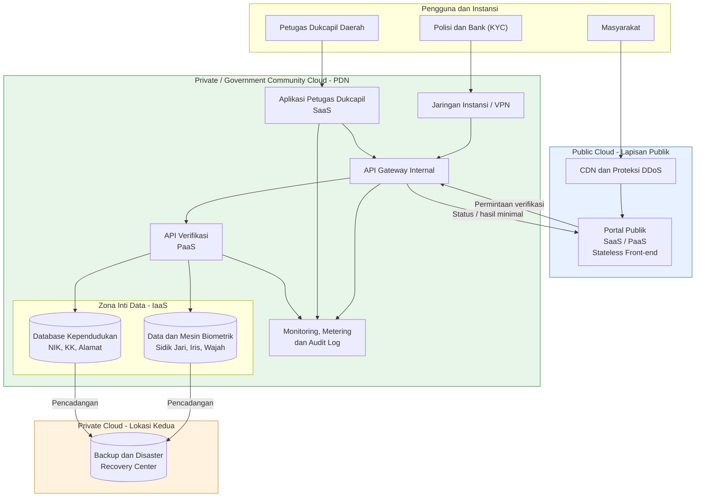

# Diagram Arsitektur Sistem Data Kependudukan

## 1. Gambaran Umum

Sistem data kependudukan menggunakan **Hybrid Cloud**. Database kependudukan dan data biometrik ditempatkan di **Private / Government Community Cloud** milik pemerintah. Sementara itu, Public Cloud hanya digunakan untuk lapisan depan yang bersifat *stateless*, seperti portal publik, CDN, dan proteksi DDoS. Dengan pembagian ini, data pribadi tetap berada di infrastruktur yang dikendalikan pemerintah, sedangkan lonjakan trafik dapat ditangani pada lapisan publik.

## 2. Diagram Arsitektur

## 3. Keterangan Komponen

| Komponen | Lokasi / Deployment | Service Model |
|---|---|---|
| Portal publik dan CDN | Public Cloud | SaaS/PaaS |
| API verifikasi | Private Cloud | PaaS |
| Database kependudukan | Private Cloud (PDN) | IaaS |
| Data dan mesin biometrik | Private Cloud (PDN), zona terisolasi | IaaS |
| Aplikasi petugas Dukcapil | Private / Community Cloud | SaaS |
| Backup dan DRC | Private Cloud, lokasi kedua | IaaS |

## 4. Alur Sistem

1. Masyarakat mengakses portal publik melalui CDN dan proteksi DDoS.
2. Portal meneruskan permintaan verifikasi ke API Gateway di Private Cloud.
3. API verifikasi memproses permintaan dan mengakses database kependudukan atau mesin biometrik sesuai kebutuhan.
4. Sistem mengirimkan hasil atau status yang diperlukan ke portal, tanpa membuka seluruh data kependudukan.
5. Petugas Dukcapil menggunakan aplikasi terpusat, sedangkan polisi dan bank mengakses API verifikasi melalui jaringan instansi atau VPN.
6. Database kependudukan dan data biometrik dicadangkan ke DRC di lokasi berbeda.

## 5. Batas Keamanan

- Database NIK, KK, alamat, dan data biometrik tetap berada di Private Cloud pemerintah.
- Public Cloud hanya menangani lapisan depan yang *stateless* dan tidak menyimpan data pribadi.
- Pertukaran data antara portal publik dan layanan inti dibatasi pada permintaan yang diperlukan serta hasil atau status minimal.
- Akses instansi dilakukan melalui jalur yang terkontrol, dengan autentikasi dan pembatasan hak akses.
- Monitoring, metering, dan audit log digunakan untuk memantau penggunaan layanan serta aktivitas akses.

> Diagram ini merupakan visualisasi dari analisis kelompok mengenai Hybrid Cloud dan pembagian service model pada setiap komponen sistem.
